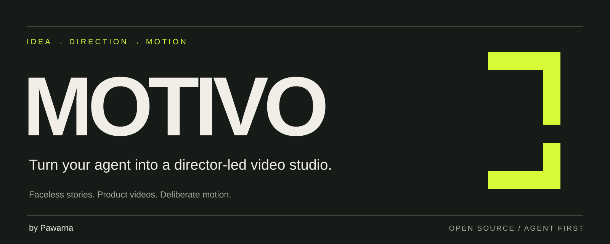
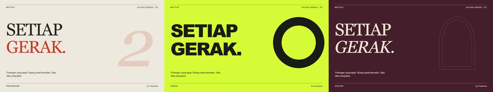
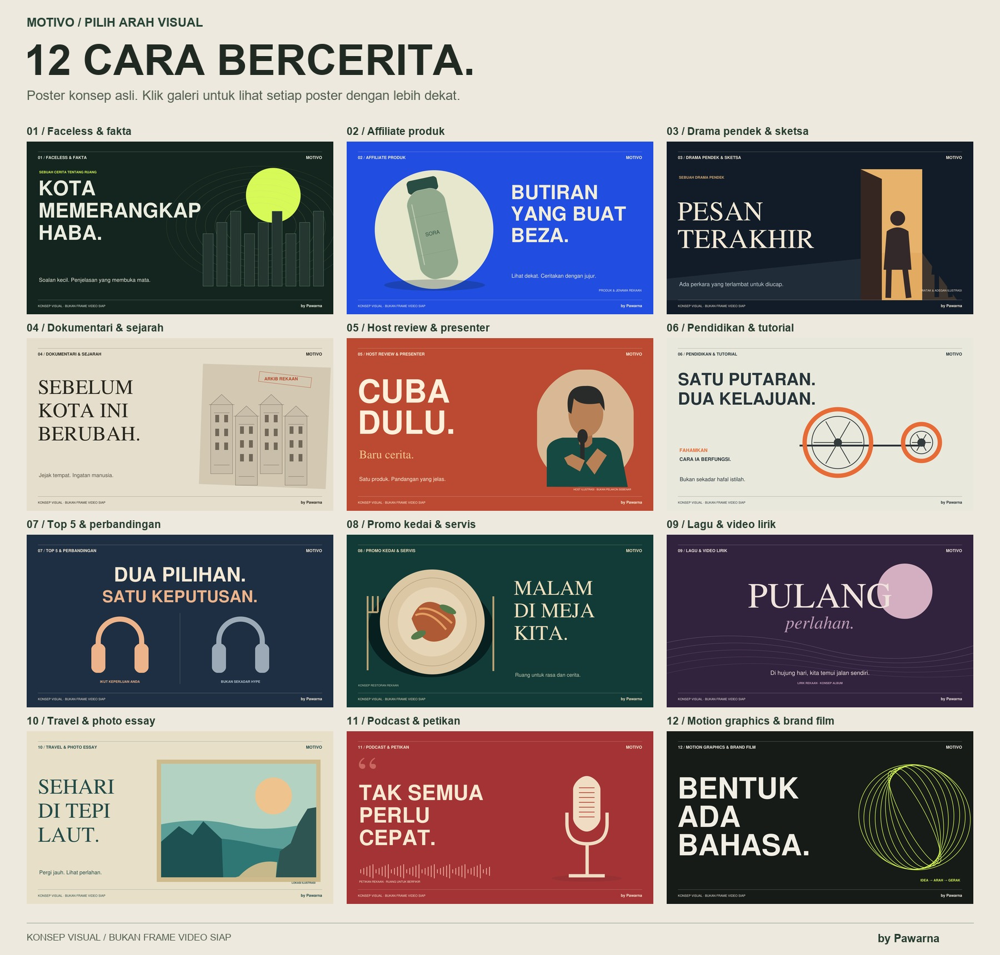

<p align="center">
  <a href="https://github.com/ridzuantanix-boop/motivo/actions/workflows/check.yml"></a>
  <a href="LICENSE"></a>
  
  
</p>

<p align="center"><a href="START_HERE.md">New? Start here</a> · <a href="docs/STYLE_GALLERY.md">Visual gallery</a> · <a href="#local-setup">Quick start</a> · <a href="docs/PROVIDERS.md">Keys &amp; voices</a> · <a href="docs/README.ms.md">Bahasa Melayu</a> · <a href="CONTRIBUTING.md">Contribute</a></p>

# Your agent has an idea. Give it a director's toolkit.

Give your coding agent a brief. Build faceless stories, product videos, and deliberate motion graphics through conversation, using Remotion and FFmpeg locally.

**Agent-first · Local rendering · Open source · Optional Nexabot**



MOTIVO is a repository-based skill and production kit, not a dashboard. Your agent supplies reasoning and code execution. Supplied media and motion graphics need no media-generation API. Generating new AI footage or voices requires a separately configured provider and may cost money.

## Start with a conversation

**No manual ZIP download needed** if your agent can clone GitHub repositories. Paste this into your coding agent:

```text
Set up MOTIVO from https://github.com/ridzuantanix-boop/motivo in a new
project folder. Read AGENTS.md and the MOTIVO skill. Install dependencies,
check setup, then guide me through my first video. I am a beginner.
Do not generate media, spend API credits or publish anything yet.
```

Already installed? Say **“Buka MOTIVO dan bimbing aku buat video pertama. Aku baru mula.”** The agent should guide your video idea, visual sources and voice choice one step at a time. It should help configure only the provider you choose, then prepare a usable first brief. [Beginner guide](START_HERE.md).

For an explicit project-local entry point:

```text
Read AGENTS.md and use the MOTIVO skill. Check setup without making a video.
```

Then try:

```text
Buat video affiliate 30 saat daripada gambar dalam public/assets/botol/.
Gaya editorial premium, 9:16. Jangan reka testimoni atau harga.
```

```text
Turn my script and photos into a faceless essay. Propose an art direction,
build a shotlist, then compose the edit. Use my recorded narration.
```

```text
Create an original motion explainer. Avoid dashboard cards and stock
animation patterns. Explain the mechanism visually, with room to read.
```

## Local setup

Use Node.js 22+, Python 3.10+, FFmpeg and FFprobe on PATH. Python is used by the optional Nexabot client; FFmpeg supports media preparation and inspection.

```sh
git clone https://github.com/ridzuantanix-boop/motivo.git
cd motivo
npm ci
npm run setup
npm run typecheck
npm run studio
```

On Windows PowerShell use `npm.cmd` and `npx.cmd`. Setup creates `.env` only when absent, checks tools, and never contacts Nexabot. Leave the API key empty for local work. Never commit credentials.

Open a `Motivo-*` composition: **Pressroom**, **Signal**, or **Atelier**, independently laid out for portrait and landscape. These are silent, original typography/geometry studies, not finished customer videos. `StarterDemoVideo` remains a legacy reference.

| Direction | Visual language | Starting use |
|---|---|---|
| Pressroom | Paper, ink, monumental serif, editorial asymmetry | Essays and culture |
| Signal | Acid green, bold type, directional geometry | Explainers and launches |
| Atelier | Oxblood, parchment, restrained type, architectural curves | Product narratives |

Seven **narrative recipes**, separate from styles: faceless essay, ranked discovery, product detail, product comparison, visual explainer, place & culture, and short drama/sketch. These are agent instructions, not seven one-click video generators. The agent adapts code and real assets to each brief.

## What can I make?

The first-run agent menu offers **12 use cases**: faceless facts, affiliate products, short drama/sketches, documentaries/history, host reviews, tutorials, lists/comparisons, business promos, songs/lyrics, travel/photo essays, podcast excerpts and motion graphics. Several use cases share a narrative recipe. [Explore the catalog, examples and asset requirements](docs/VIDEO_TYPES.md).

**Choose by look, not just a name.** Each type has an original illustrated concept poster. Click the overview for individual posters and art-direction notes. These show visual intent, not finished video frames or proof of generated live-action realism.

[](docs/STYLE_GALLERY.md)

Try: “Use poster 3's lighting and mood for my family drama” or “Combine poster 4's typography with poster 10's colors.” Your agent can adapt the direction instead of locking you to a preset.

**Short drama is included as a guided workflow:** supplied live-action footage, illustrated/photo drama with narration/dialogue, or optional generated clips. The agent plans the script, character/voice continuity, coverage, sound and edit. Narration alone does not provide synchronized speaking faces; generated actors and lip-sync require provider support, budget and temporal inspection. No finished drama sample or automatic multi-speaker pipeline is bundled.

## Connect your agent

- **Codex:** open the repo as a workspace and explicitly ask it to read `AGENTS.md` and `.agents/skills/motivo/SKILL.md`. A global install is unnecessary for this project-local workflow.
- **Antigravity or another coding agent:** open the folder and ask it to read those same files. Import through the agent's supported skill mechanism if available. Automatic discovery varies and is not assumed.
- **Other agents:** an agent that can read files, edit TSX and execute Node commands can follow the manual entry point. Cross-agent integrations have not all been independently tested.

An agent subscription does not automatically supply programmatic voice, image, or video generation.

## Production workflow

Brief → asset audit → art direction → shotlist → composition → inspected draft → final export.

Keep direction, sources, shot timing, and review evidence in `projects/<slug>/`. MOTIVO discourages generic glass panels, automatic particles, endless springs and uniform layouts. It calls for subject-specific decisions and records what was actually inspected. No preset guarantees artistic quality, photorealism, virality, monetization eligibility, or income.

The live-action guide covers continuity, anatomy, physics, product fidelity, speech, modest wardrobe for Malay productions, and temporal inspection. Repair or replace defective footage. Verify the inherited Nexabot endpoint/model guidance against current official documentation before paid generation.

## Choose your voice route

| Route | Key in MOTIVO | How it works |
|---|---|---|
| Your recording | None | Give the audio file to your agent |
| Google AI Studio manual | None | Agent prepares the script; you generate/download audio in the speech playground |
| Google API narration | Your Gemini API key | Optional Python REST client; dry run by default, explicit generation only |
| Nexabot | Your Nexabot API key | Provider-specific assets/narration; retain original host audio for lip-sync |
| No narration | None | Deliberately silent or music-led, as briefed |

Keys stay in local `.env` or process environment. The `connect` command takes hidden input in your own interactive terminal; do not paste keys into chat or command arguments. Google account sign-in is different from API access. Provider quotas, model access and costs vary. [Step-by-step key and voice guide](docs/PROVIDERS.md).

## Commands

| Command | Result |
|---|---|
| `npm run setup` | Local prerequisite check; creates optional `.env` |
| `npm run providers` | Local redacted key-presence status; no network (Python required) |
| `npm run connect -- nexabot` / `npm run connect -- google` | User-run hidden terminal key input into local `.env` (Python required) |
| `npm run provider:check -- google` / `npm run provider:check -- nexabot` | Explicit read-only authentication check; no media generated |
| `npm run studio` | Interactive composition preview |
| `npm run typecheck` | TypeScript validation |
| `npm run build` | Browser bundle in `dist/`; no video or API calls |
| `npm run inspect` | After build: 18 static frames across three styles and two ratios in `out/inspection/`; not a motion/audio review |
| `npm run gallery` | After build: export the 12 static `Gallery-*` poster compositions to `docs/gallery/`; no video or API calls |
| `npx remotion still src/index.ts Motivo-pressroom-Landscape out/frame.png --frame=60` | Inspection frame |
| `npx remotion render src/index.ts Motivo-pressroom-Landscape out/study.mp4` | Explicit MP4 export |

Frame rendering may download Remotion's browser on first use. The studies contain no audio; customer productions use supplied recordings, licensed tracks, or explicitly configured voice generation.

## Repository map

```text
AGENTS.md                          Project entry point
.agents/skills/motivo/              Director workflow and review references
.agents/skills/nexabot-video-studio/ Preserved starter provider guidance
src/MotivoStudy.tsx                 Three direction studies
src/components/                    Optional legacy starter components
scripts/setup.mjs                  Non-destructive local check
scripts/nexabot_client.py           Optional inherited provider client
```

## Troubleshooting and sharing

Missing tool: install it, add it to PATH, and reopen the terminal. API `401`: replace the optional key; local compositions still work. Missing media: supply assets and correct paths. A bundle passing does not prove motion/audio quality; inspect output.

Code is MIT licensed, **by Pawarna**. Dependencies retain their licenses; check Remotion's current licensing terms for your use. User assets, music, fonts, provider usage, and generated outputs are not licensed by this repo's MIT license. MOTIVO requires no export watermark. See [CONTRIBUTING.md](CONTRIBUTING.md).

## Release status

**v0.3.0 adds a visual concept gallery to guided onboarding and drama direction.** Static poster previews, provider offline tests and six motion composition studies have been inspected/validated as recorded; universal agent installation, live provider generation and an end-to-end drama production have not. See the [validation record](docs/VALIDATION.md) and [changelog](CHANGELOG.md). Follow [SECURITY.md](SECURITY.md) when reporting sensitive issues.
