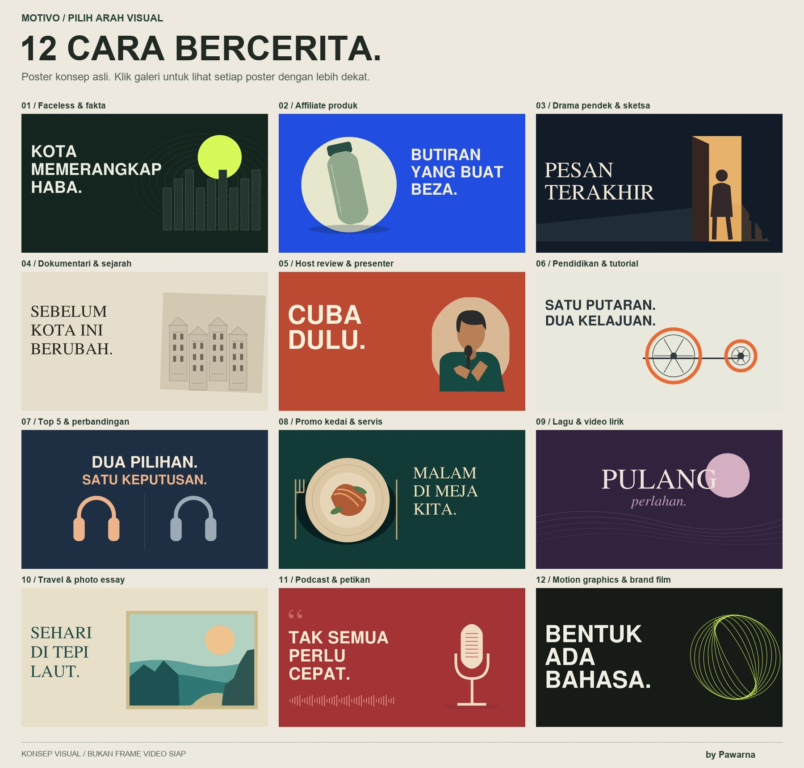

# Baru install? Cakap ini kepada agent.

> **Buka MOTIVO dan bimbing aku buat video pertama. Aku baru mula.**

Agent patut membimbing anda satu langkah pada satu masa: pilih video, bahan visual dan suara. Anda tak perlu hafal arahan terminal, nama model atau format API.

**Semua jenis guna gaya clean:** visual jadi fokus; tiada label kecil di penjuru, watermark atau overlay melekat secara automatik. Teks muncul hanya bila membantu cerita, dengan saiz jelas dan masa masuk/keluar. Sarikata, lirik atau label diagram yang diperlukan tetap boleh digunakan. [Lihat panduan clean](docs/CLEAN_STYLE.md).

Agent juga patut tunjuk senarai jenis video: **faceless, affiliate, drama pendek/sketsa, dokumentari, host review, tutorial, Top 5/perbandingan, promo, lagu/lirik, travel, podcast dan motion graphics**. Pilih nombor atau terus bagi idea. [Lihat katalog dan bahan yang diperlukan](docs/VIDEO_TYPES.md).

## Pilih melalui rupa

[](docs/STYLE_GALLERY.md)

Klik [galeri poster](docs/STYLE_GALLERY.md) untuk lihat contoh besar dan arah visual setiap pilihan. Ini poster konsep berilustrasi, bukan frame video siap. Cakap kepada agent: **“Aku suka poster 3. Guna mood itu untuk cerita aku.”** Gaya boleh diubah atau digabungkan.

| Nak buat apa? | Cakap kepada agent |
|---|---|
| Faceless | “Aku nak video fakta 30 saat. Tolong cadangkan topik dan gaya.” |
| Affiliate | “Aku ada gambar produk. Bantu tulis skrip dan susun video 9:16.” |
| Drama pendek | “Bantu buat sketsa komedi dua watak, 45 saat. Cadangkan skrip dan laluan produksi dulu.” |
| Senarai pilihan | “Tunjukkan semua jenis video yang MOTIVO boleh bantu buat, termasuk bahan yang diperlukan.” |
| Sambung Nexabot | “Bimbing aku sambung Nexabot. Tunjuk tempat isi key secara tempatan.” |
| Suara Google tanpa API | “Sediakan skrip dan bimbing aku guna Google AI Studio manual.” |
| Suara Google automatik | “Bimbing aku sambung Google API untuk narasi. Jangan jana audio dulu.” |
| Guna bahan sendiri | “Aku nak guna gambar dan rakaman suara sendiri, tanpa API.” |

## Pilihan suara paling mudah

**Ada rakaman?** Berikan lokasinya kepada agent.

**Nak suara AI, belum ada key?** Agent sediakan skrip. Buka [Google AI Studio — Generate speech](https://aistudio.google.com/generate-speech), jana/dengar audio melalui akaun sendiri, kemudian download. Beritahu agent tempat fail disimpan. Cara manual ini tidak memerlukan key Google dalam MOTIVO; akses dan had tertakluk kepada Google.

**Nak automatik dari agent?** Gunakan key Google API sendiri. Agent akan bimbing mendapatkan key melalui [AI Studio API keys](https://aistudio.google.com/apikey) dan menyimpannya secara tempatan. Penggunaan API mungkin melibatkan kuota atau bayaran.

## Di mana nak isi key?

Key Nexabot dan Google ialah dua key berasingan. Login Antigravity bukan API key kedua-duanya.

Cara melalui editor: minta agent buka `.env`, kemudian tampal key selepas `=` pada baris provider yang dipilih. Jangan kongsi key dalam chat atau issue GitHub. Isi yang diperlukan sahaja:

```env
NEXABOT_API_KEY=
GEMINI_API_KEY=
```

Cara input tersembunyi: jalankan `npm run connect -- nexabot` atau `npm run connect -- google` dalam terminal interaktif anda sendiri (Windows: `npm.cmd`). Key tidak dipaparkan. Perlu Python 3.10+; jika tiada, guna editor.

Menyimpan key tidak menjana video/audio. Minta “semak sambungan sahaja” untuk semakan baca sahaja. Beritahu idea video bila anda sedia. [Panduan provider](docs/PROVIDERS.md)
