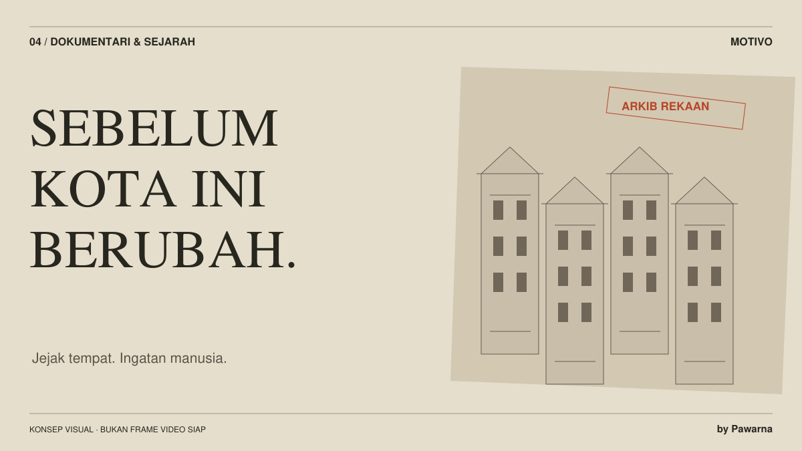
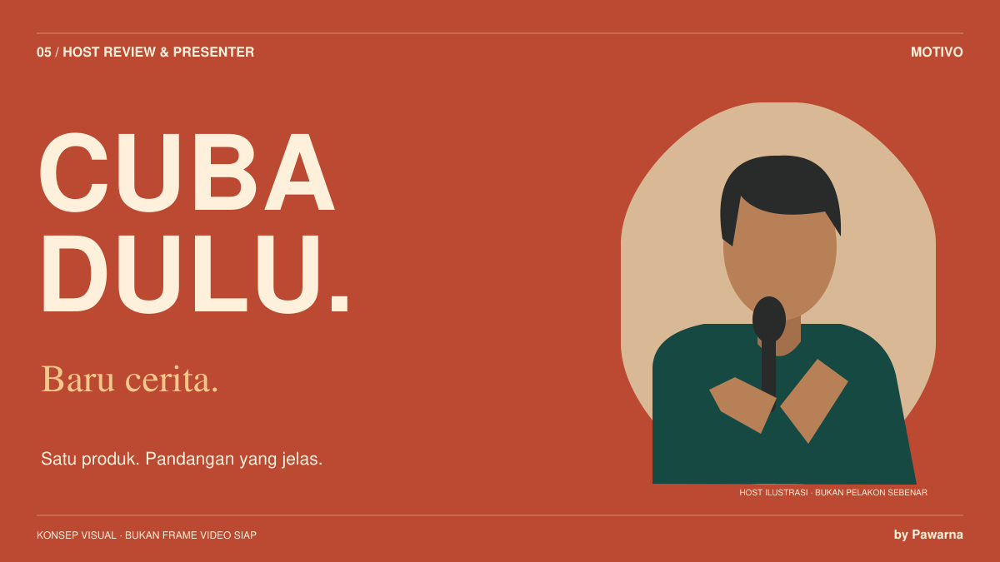
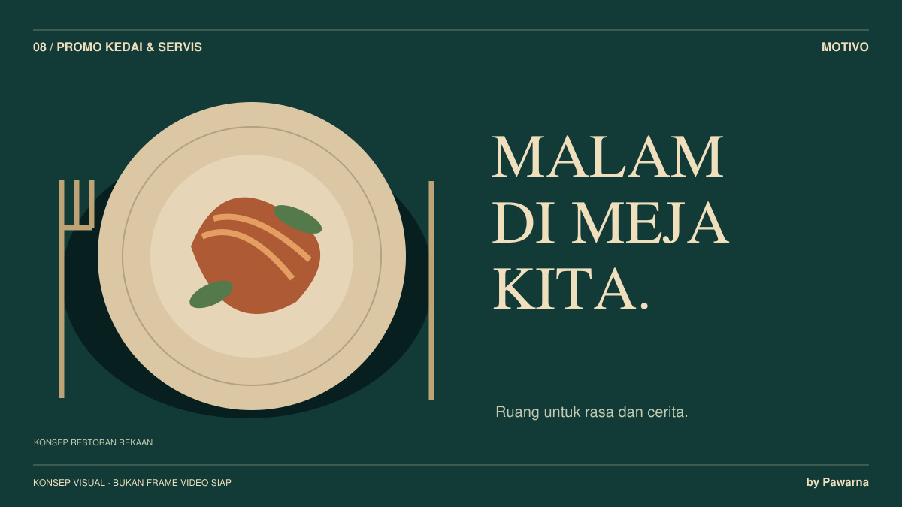
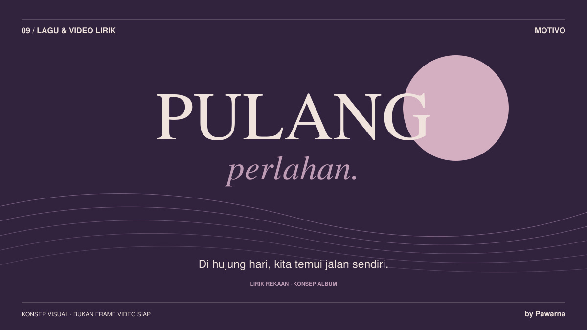
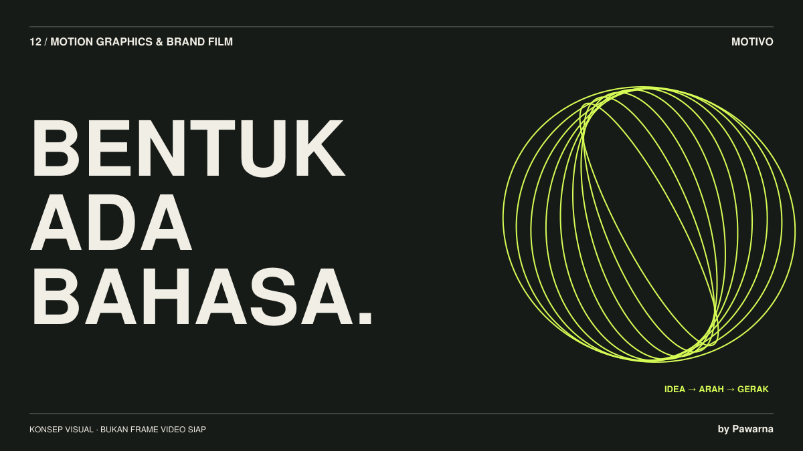

# Pilih gaya melalui rupa

12 poster konsep asli untuk membantu memilih arah visual. Klik poster untuk versi besar. Nombor sama dengan menu jenis video; palet, tipografi dan komposisi boleh disesuaikan dengan brief anda.

**Ini poster konsep berilustrasi, bukan frame video siap atau bukti hasil rakaman AI.** Ia menunjukkan mood, susunan visual dan tipografi; gerakan, audio dan realisme dinilai dalam produksi sebenar.

| | |
|---|---|
| **01 · Faceless & fakta**  Ink gelap, cahaya asid, peta kontur dan hierarki dokumentari. | **02 · Affiliate produk**  Object-led, biru elektrik, ruang kosong dan close-up produk rekaan. |
| **03 · Drama pendek & sketsa**  Ilustrasi sinematik: cahaya pintu, siluet, ruang sunyi dan tajuk serif. | **04 · Dokumentari & sejarah**  Editorial arkib: kertas, dakwat, lukisan bangunan dan cap vermilion. |
| **05 · Host review & presenter**  Presenter ilustrasi, terracotta, framing bersih dan suara terus ke kamera. | **06 · Pendidikan & tutorial**  Diagram mekanikal, anotasi tepat dan gerak yang menerangkan konsep. |
| **07 · Top 5 & perbandingan**  Komposisi berpasangan, warna kontras dan perbandingan yang adil. | **08 · Promo kedai & servis**  Hospitaliti editorial: hijau gelap, ilustrasi hidangan dan tipografi hangat. |
| **09 · Lagu & video lirik**  Malam ungu, horizon berlapis, lirik asli dan ruang seperti sleeve album. | **10 · Travel & photo essay**  Travel journal: bingkai cetakan, ilustrasi pesisir dan serif yang lapang. |
| **11 · Podcast & petikan**  Spoken-word editorial, mikrofon ilustrasi dan petikan asli yang dominan. | **12 · Motion graphics & brand film**  Brand specimen: dakwat, tipografi grotesk dan geometri berirama. |

## Cara pilih

> Aku pilih poster 3. Aku suka mood cahaya dan ruangnya, tetapi nak cerita komedi keluarga. Cadangkan skrip 45 saat dan sesuaikan gaya itu. Jangan jana aset berbayar dulu.

> Gabungkan tipografi poster 4 dengan warna poster 10 untuk video faceless tentang kampung aku.

Poster bukan sempadan kreativiti atau janji hasil serupa tanpa bahan yang sesuai. Agent boleh bina arah baharu. Untuk host/drama realistik, gunakan rakaman sendiri atau rancang penjanaan provider secara berasingan; figura dalam galeri ialah ilustrasi, bukan pelakon sebenar.

## Sumber dan bina semula

Semua lukisan, objek, figura, lokasi, lirik dan jenama contoh dalam poster ialah rekaan grafik asli. Tiada foto stok atau panggilan API digunakan. Sumber SVG berada dalam `public/gallery/`, dijana oleh `scripts/gallery_art.py`, dan dimasukkan ke komposisi `Gallery-*` di Studio. Ini komposisi poster satu frame, bukan templat video penuh.

Untuk bina semula: `python scripts/gallery_art.py`, `npm run build`, kemudian `npm run gallery`. JPEG yang dirender berada dalam `docs/gallery/`. Helaian ringkasan boleh dibina semula dengan `python scripts/gallery_contact.py` (Pillow diperlukan untuk alat dokumentasi pilihan ini sahaja). Kod/grafik galeri menggunakan lesen MIT repo; fon sistem tidak dibundel.

Alternatif memori rendah: `python scripts/gallery_raster.py` dengan PyMuPDF. Fon/rasterizer boleh memberi perbezaan kecil; semak hasil visual. PyMuPDF dan Pillow ialah alat dokumentasi pilihan dengan lesen masing-masing, bukan dependencies setup atau runtime video.

[Katalog dan keperluan bahan](VIDEO_TYPES.md) · [Mula di sini](../START_HERE.md)
