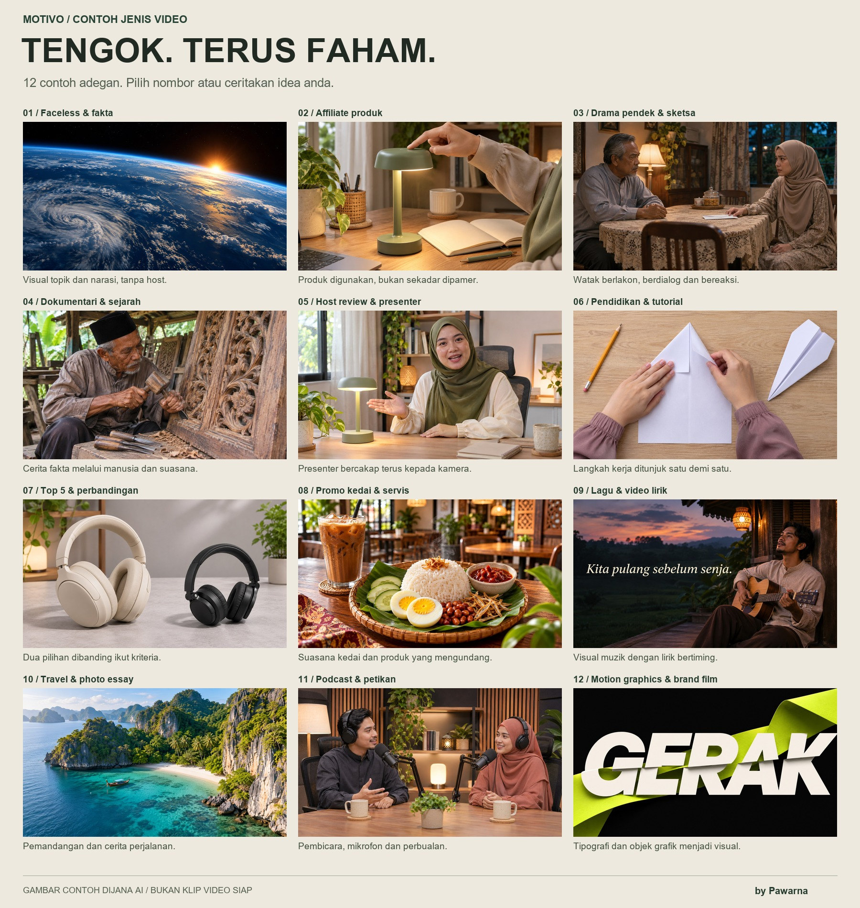
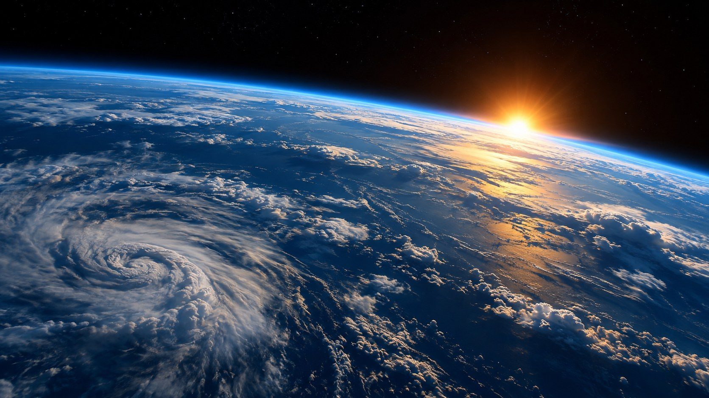
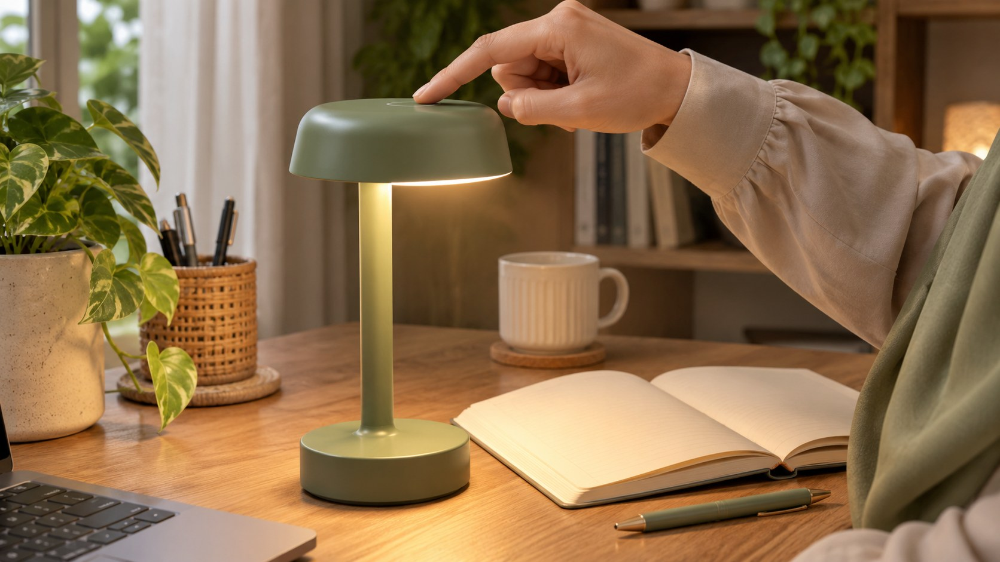
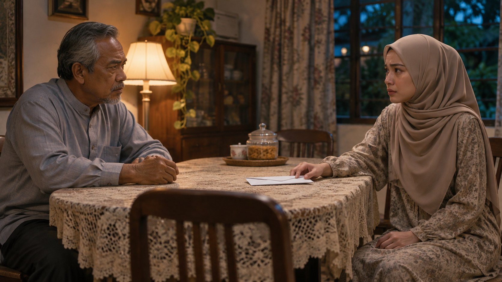
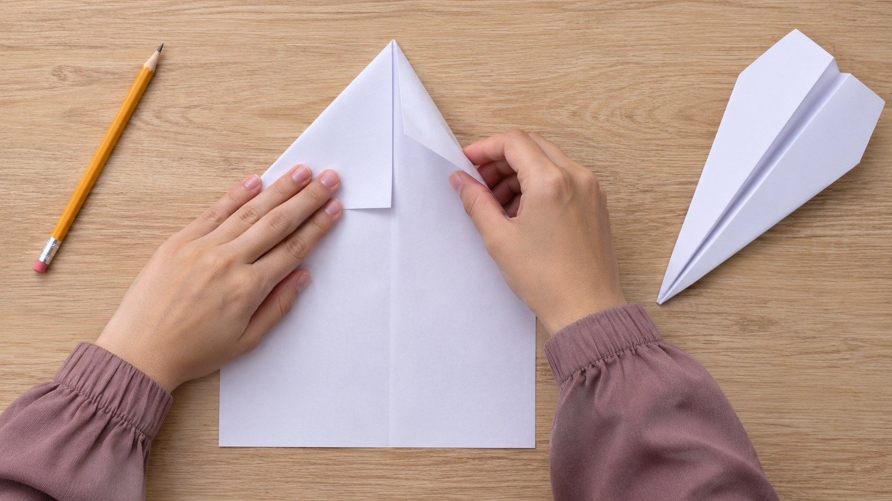
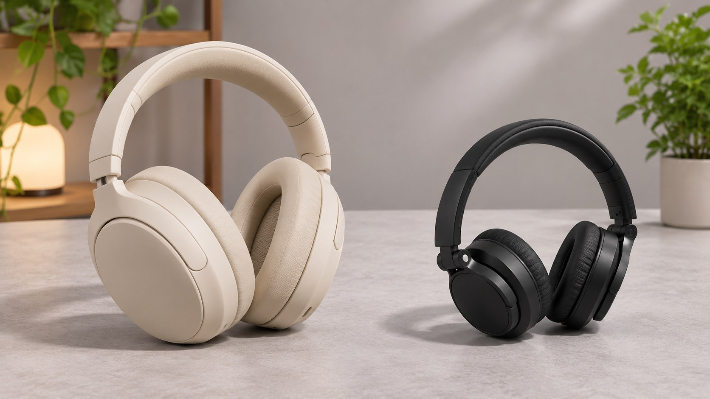
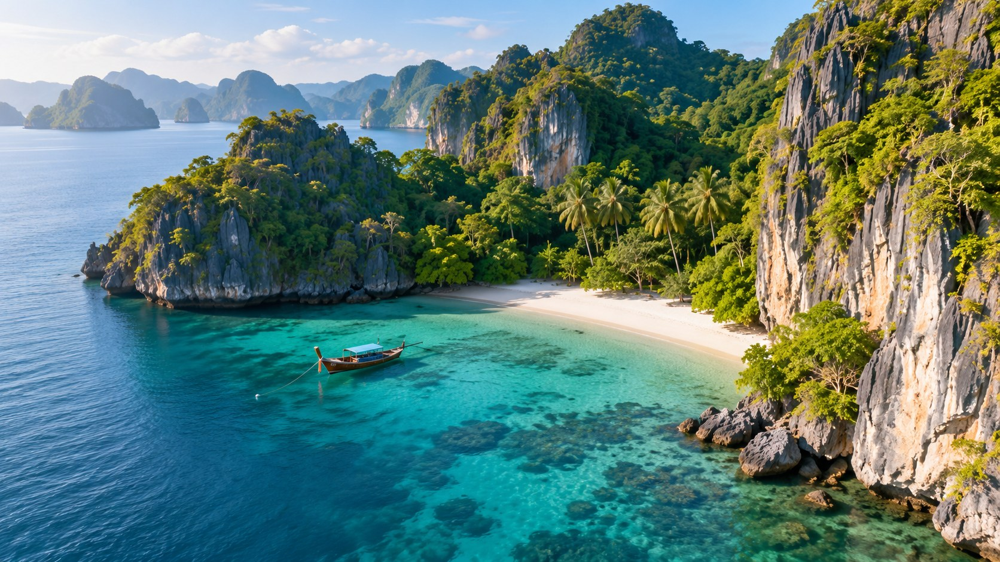
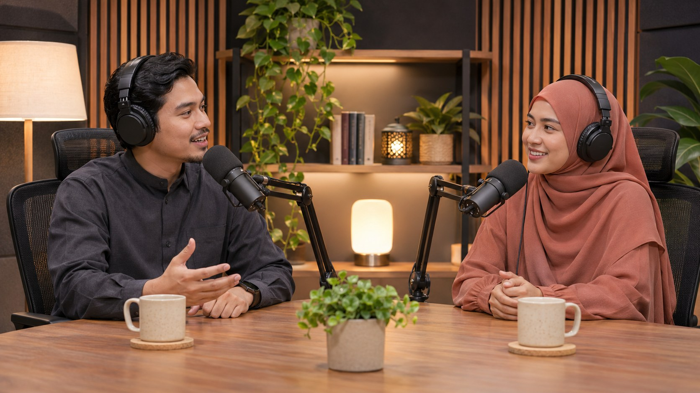

# Tengok contoh, terus faham jenis videonya

Drama ditunjukkan dengan watak sedang berlakon. Review ada presenter dan produk. Podcast ada pembicara dan mikrofon. Pilih berdasarkan contoh adegan dan penerangan di bawah, bukan nama atau palet warna sahaja.

**Semua gambar di sini dijana AI sebagai contoh visual genre — bukan klip video siap atau hasil Nexabot yang telah diuji.** Watak, produk dan suasana adalah rekaan. Gambar statik tidak membuktikan gerakan, konsistensi watak atau lip-sync.

## Pilih satu contoh

Klik mana-mana gambar untuk lihat versi besar. Nama kategori dan penerangan berada di luar frame. Visual kekal clean; contoh lirik/typografi sahaja menunjukkan teks sebagai kandungan utama.

| | |
|---|---|
| **01 · Faceless & fakta**  **Rupanya:** Contoh saluran fakta: visual angkasa memenuhi skrin sementara narator menerangkan topik. **Dalam video:** B-roll bertukar ikut isi; suara latar dan sarikata jika diminta. | **02 · Affiliate produk**  **Rupanya:** Tangan menunjukkan cara lampu digunakan. Produk dan manfaat yang dibuktikan menjadi fokus. **Dalam video:** Close-up, demonstrasi, ulasan ringkas dan CTA bertiming. |
| **03 · Drama pendek & sketsa**  **Rupanya:** Ayah dan anak berdepan satu konflik di meja makan. Ekspresi dan hubungan watak membina cerita. **Dalam video:** Shot dialog, reaksi, jeda, bunyi suasana dan kesinambungan watak. | **04 · Dokumentari & sejarah**  **Rupanya:** Tukang kayu sedang bekerja; ini rupa B-roll dokumentari tentang manusia atau warisan. **Dalam video:** Rakaman pemerhatian, temu bual/narasi dan fakta yang disahkan. |
| **05 · Host review & presenter**  **Rupanya:** Host mengulas sambil menunjukkan produk di hadapannya, seperti video review creator. **Dalam video:** Dialog host, demonstrasi/close-up produk dan potongan sokongan. | **06 · Pendidikan & tutorial**  **Rupanya:** Kamera atas meja menunjukkan tindakan tangan dan hasil yang hendak dicapai. **Dalam video:** Langkah berurutan, penerangan jelas dan label hanya jika membantu. |
| **07 · Top 5 & perbandingan**  **Rupanya:** Dua produk dilihat bersama supaya perbezaannya boleh diterangkan dengan adil. **Dalam video:** Potongan setiap produk, kriteria perbandingan dan rumusan berasas. | **08 · Promo kedai & servis**  **Rupanya:** Hidangan, minuman dan suasana kafe seperti dalam video promosi makanan. **Dalam video:** Detail makanan, suasana, tawaran sebenar jika dibekalkan dan CTA akhir. |
| **09 · Lagu & video lirik**  **Rupanya:** Visual seperti klip muzik, dengan satu baris lirik besar yang mudah dibaca. **Dalam video:** Muzik berlesen/milik sendiri, visual ikut frasa dan lirik yang bertukar. | **10 · Travel & photo essay**  **Rupanya:** Pemandangan destinasi seperti dalam travel film; lokasi sebenar perlu guna aset/sumber yang sah. **Dalam video:** Establishing shot, aktiviti/detail tempat dan narasi/bunyi suasana pilihan. |
| **11 · Podcast & petikan**  **Rupanya:** Dua orang bersembang dalam studio podcast, dengan potongan antara pembicara. **Dalam video:** Audio perbualan, reaksi, petikan dan sarikata jika diminta. | **12 · Motion graphics & brand film**  **Rupanya:** Huruf dan bentuk tiga dimensi seperti satu momen dalam brand film atau motion design. **Dalam video:** Gerak bersebab, perubahan bentuk/komposisi dan sound design terpilih. |

## Contoh arahan kepada agent

> Aku pilih nombor 3. Nak drama keluarga macam adegan ayah dan anak itu, 45 saat. Cadangkan cerita, dialog dan shot reaksi dahulu. Jangan jana klip berbayar dulu.

> Aku pilih nombor 5. Aku nak host review lampu meja aku. Guna gambar produk sebenar dan bimbing aku sediakan host serta dialog.

> Aku pilih nombor 11. Aku ada rakaman podcast. Pilih petikan menarik dan susun versi pendek yang clean.

Jenis boleh bertindih: dokumentari boleh faceless, promo boleh menggunakan host, dan affiliate boleh mengandungi tutorial. Gambar ini menunjukkan satu pendekatan yang mudah difahami; subjek, mood dan gaya boleh diubah. Untuk drama/review realistik, perlu rakaman sendiri atau provider penjanaan dengan akses, rujukan dan bajet yang sesuai.

## Sumber dan penyelenggaraan

Contoh baharu dijana menggunakan built-in imagegen. [Nota aset](../public/gallery/ASSETS.md) dan [set prompt](../public/gallery/PROMPTS.json) merekodkan sumber. JPEG utama berada dalam `public/gallery/`; salinan paparan berada dalam `docs/gallery/`. Tiada rujukan individu sebenar, foto stok atau key provider dibundel.

`python scripts/gallery_docs.py` membina metadata Studio dan halaman ini daripada `public/gallery/gallery.json`; ia tidak menjana imej. `npm run build` kemudian `npm run gallery` mengeksport semula komposisi poster satu frame daripada JPEG sedia ada. `python scripts/gallery_contact.py` menyusun helaian ringkasan dengan Pillow (alat dokumentasi pilihan). Pipeline SVG abstrak lama telah diganti.

[Katalog dan keperluan bahan](VIDEO_TYPES.md) · [Mula di sini](../START_HERE.md) · [Gaya clean](CLEAN_STYLE.md)
