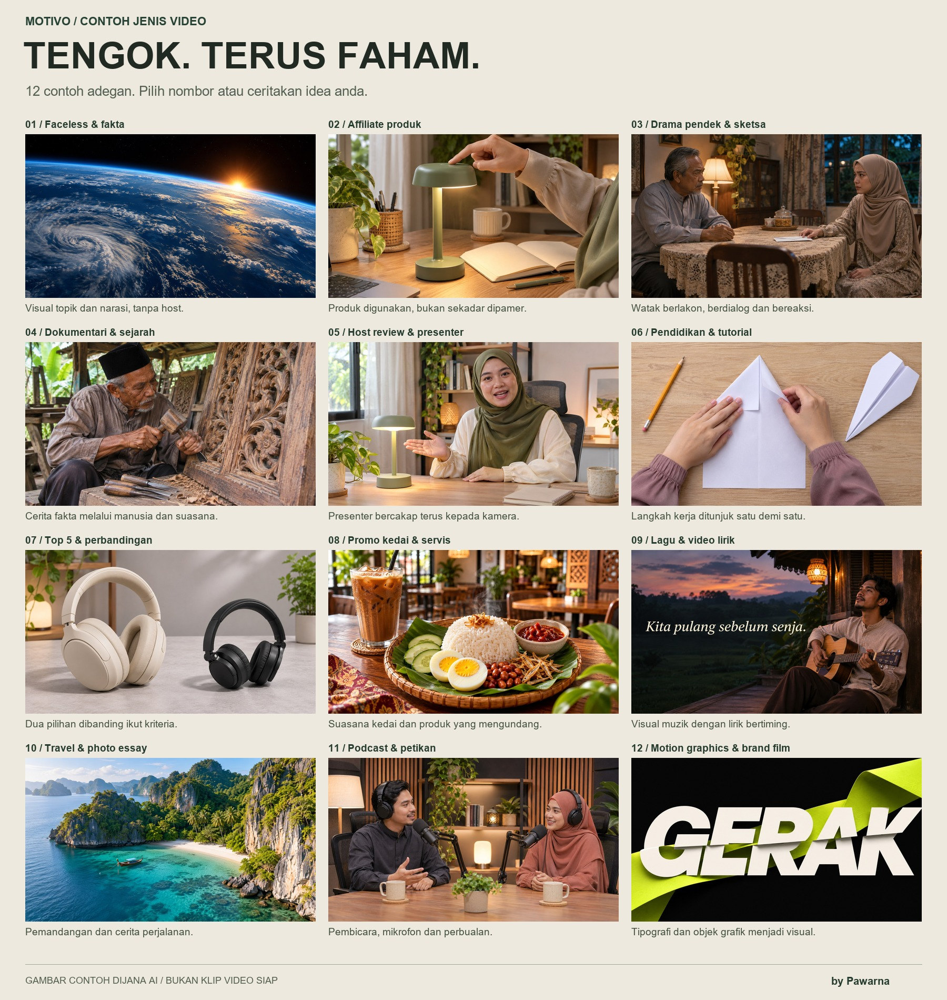

# Video apa yang boleh dibuat dengan MOTIVO?

Pilih nombor atau terus ceritakan idea. Agent membantu menulis, merancang, menyunting dan merender. Senarai ini ialah pilihan kegunaan, **bukan 12 generator atau templat siap satu klik**. Hasil bergantung pada bahan, alat dan provider yang tersedia.

**Nak terus faham rupanya?** [Buka galeri 12 contoh adegan](STYLE_GALLERY.md). Drama menunjukkan watak berlakon, review menunjukkan host dengan produk, podcast menunjukkan perbualan studio. Nombor sepadan dengan senarai di bawah. Gambar dijana AI untuk menerangkan genre, bukan klip video siap.

| No. | Jenis video | Contoh idea | Bahan/laluan |
|---|---|---|---|
| 1 | Faceless & fakta | “Kenapa bandar lebih panas?” | Gambar/klip + narasi; boleh tanpa API penjanaan |
| 2 | Affiliate produk | Ciri, manfaat, demo, masalah → penyelesaian | Aset/spec produk sebenar; jangan reka pengalaman/testimoni |
| 3 | Drama pendek & sketsa | Keluarga, komedi, misteri, kisah pengajaran | Rakaman sendiri, drama bergambar atau klip AI pilihan |
| 4 | Dokumentari & sejarah | Tokoh, peristiwa, asal-usul sesuatu | Sumber fakta + visual; ilustrasi AI bukan bukti sejarah |
| 5 | Host review & presenter | Host menerangkan produk/lokasi | Rakaman host sendiri atau penjanaan video dengan dialog |
| 6 | Pendidikan & tutorial | Terangkan konsep atau langkah penggunaan | Diagram, rakaman skrin, contoh sebenar + suara pilihan |
| 7 | Top 5 & perbandingan | Senarai berasas atau dua produk untuk kegunaan berbeza | Kriteria/sumber dan ulasan asli |
| 8 | Promo kedai & servis | Menu, hartanah, acara, tawaran sebenar | Gambar, maklumat sah, CTA dan audio pilihan |
| 9 | Lagu & video lirik | Lagu sendiri, ucapan bermuzik, karaoke | Lagu berlesen/milik sendiri + lirik/timing; lagu AI perlu provider tambahan |
| 10 | Travel & photo essay | Cerita lokasi daripada gambar percutian | Foto/klip sendiri + fakta/narasi pilihan |
| 11 | Podcast & petikan | Sorotan perbualan dengan sarikata | Audio/video asal + transkrip atau alat transkripsi yang tersedia |
| 12 | Motion graphics & brand film | Pelancaran jenama, tipografi, visual data | Grafik/kod + aset berlesen; tidak wajib guna API |

Untuk rakaman baharu yang dijana AI, perlu provider seperti Nexabot dengan akses dan bajet sendiri. Untuk bahan sendiri dan motion graphics, tiada API penjanaan diperlukan. Google TTS menghasilkan suara; ia tidak menghasilkan klip pelakon atau lip-sync. Tiada jaminan monetisasi atau rakaman AI sempurna realistik.

## Ya, drama pendek pun boleh

Tiga laluan yang boleh dipilih:

- **Rakaman sendiri:** agent menulis skrip, mencadangkan shot, menyusun klip, audio dan sarikata. Rakaman pelakon datang daripada anda.
- **Drama bergambar:** gambar atau ilustrasi disusun dengan potongan, narasi/dialog dan bunyi. Mulut watak tidak didakwa bergerak sepadan dengan dialog.
- **Drama klip AI:** agent merancang shot dan menggunakan provider yang dipilih selepas izin penjanaan. Konsistensi wajah, pakaian, lokasi, suara dan lip-sync perlu diperiksa; hasil mungkin perlu dibaiki atau diganti.

Untuk cerita pertama, agent boleh mencadangkan 30–60 saat, dua watak dan satu lokasi, kemudian menyesuaikannya dengan idea anda. Ini cadangan produksi yang mudah dikawal, bukan had MOTIVO. Gunakan setup → konflik → perubahan → penamat; dialog patut terdengar seperti percakapan, bukan slogan.

Contoh:

> Aku pilih 3. Buat drama pendek komedi tentang ayah dan anak berebut remote, 45 saat, Bahasa Melayu, dua watak, satu ruang tamu. Cadangkan skrip dan shotlist dahulu. Bimbing aku pilih drama bergambar atau klip Nexabot. Jangan jana aset berbayar dulu.

> Aku pilih 3. Buat drama bergambar misteri 30 saat daripada gambar aku, dengan narator Google AI Studio. Jangan buat lip-sync palsu. Bantu aku siapkan skrip dan audio dahulu.

Untuk sambung episod, agent menyimpan catatan watak dan kesinambungan dalam nota projek. Rujukan identiti/pakaian membantu konsistensi tetapi tidak menjaminnya.

[Mula di sini](../START_HERE.md) · [Key dan suara](PROVIDERS.md) · [Contoh brief](EXAMPLES.md)
